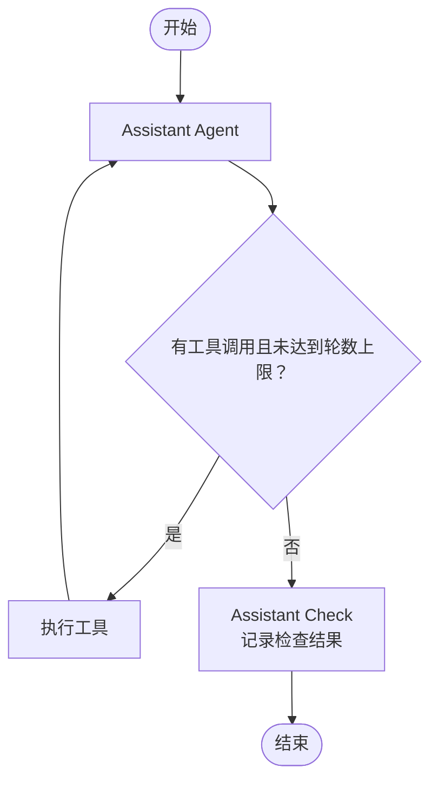
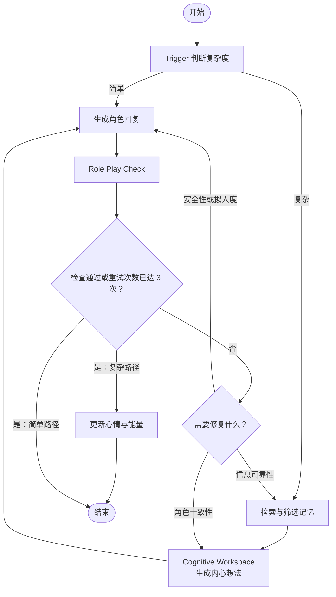

# LangGraph 角色扮演助手

一个仍在开发中的单用户、本地运行原型。项目使用 LangGraph 分别构建通用助手和角色扮演流程，并通过 FastAPI 提供接口、托管网页界面。

## 功能

- **Assistant**：通用问答、按需调用工具、网页搜索，以及根据用户请求创建角色扮演对话。
- **Role Play**：根据角色身份和人格画像生成回复；复杂交互会进入认知工作空间，再生成角色回复。
- **动态状态**：复杂交互完成检查后，模型可更新角色心情和能量；认知工作空间保存角色的内心想法。
- **对话状态**：每个对话使用独立的 `conversation_id` 作为 LangGraph `thread_id`，通过 SQLite checkpoint 保存运行状态。
- **长期记忆**：使用 Chroma 保存和检索经历、印象与关系记忆。Assistant 可查询角色最近一段对话的上下文和动态状态。

## Agent 流程

### Assistant Agent

Assistant 根据用户请求决定是否调用工具。工具执行后回到 Agent 继续生成；不调用工具或达到工具轮数上限后进入检查节点。检查节点记录任务完成度、信息充分度和安全性，不会触发重试。启用长期记忆时，后台记忆更新任务与主对话流程并行运行，并在检查后收到完成信号。



启用长期记忆时，从流程开始并行运行后台记忆更新任务；Check 完成后发送结束信号。

### Role Play Agent

Trigger 按本轮输入选择简单或复杂路径。简单路径直接生成角色回复；复杂路径先检索并筛选记忆，再生成内心想法和角色回复。Check 通过后结束本轮；未通过时按失败项回到相应节点修复，最多重试三次。复杂路径结束时会更新角色动态状态。启用长期记忆时，记忆更新任务并行运行，并在检查后收到信号。



启用长期记忆时，简单路径在 Trigger 后、复杂路径在 Cognitive Workspace 后并行启动后台记忆更新；检查通过或重试耗尽后发送信号。复杂路径的动态状态更新与记忆信号并行执行。


## 项目结构

```text
backend.py   FastAPI 接口、SQLite 会话管理和 graph 调用
main.py      本地服务启动入口
graph/       Assistant、Role Play 的 LangGraph 流程、状态和节点
memory/      Chroma 长期记忆存取
tool/        Assistant 可调用的工具
skills/      提供给 Assistant 的任务指引
frontend/    网页聊天界面
data/        运行时 SQLite 数据（自动创建，不提交到 Git）
```

## 环境要求

- Python 3.10 或更高版本
- DeepSeek API Key
- 首次使用 Chroma 向量记忆时需要网络连接，以获取默认的本地 embedding 模型
- 如需网页搜索，还需要百度 AI Search API Key

## 安装与运行

在项目根目录打开 PowerShell：

```powershell
python -m venv .venv
.\.venv\Scripts\Activate.ps1
pip install -r requirements.txt
```

在项目根目录创建 `.env` 文件：

```dotenv
DEEPSEEK_API_KEY=你的DeepSeek_API_Key

# 可选：联网搜索
BAIDU_API_KEY=你的百度_AI_Search_API_Key

# 以下配置可选；不填时使用默认值
DEEPSEEK_MODEL=deepseek-chat
DEEPSEEK_BASE_URL=https://api.deepseek.com
HOST=127.0.0.1
PORT=8000
# APP_DB_PATH=./data/app.sqlite3
# MEMORY_DB_NAME=role_play_memory
```

启动服务：

```powershell
python main.py
```

然后打开：

- 网页：<http://127.0.0.1:8000>
- API 文档：<http://127.0.0.1:8000/docs>
- 健康检查：<http://127.0.0.1:8000/health>

## 主要 API

| 方法 | 路径 | 用途 |
| --- | --- | --- |
| `GET` | `/health` | 检查服务是否运行 |
| `POST` | `/conversations` | 创建 Assistant 对话 |
| `GET` | `/conversations` | 获取对话列表 |
| `GET` | `/conversations/{conversation_id}` | 获取对话消息 |
| `POST` | `/conversations/{conversation_id}/messages` | 向指定对话发送消息 |

交互请求和响应字段可在运行后通过 `/docs` 查看。

## 数据存储

- 对话元数据和 LangGraph checkpoint 默认保存在 `data/app.sqlite3`。
- Chroma 向量记忆默认保存在 `memory/chromadb_saves/`。
- `.env`、`data/` 和 Chroma 数据目录已加入 `.gitignore`。请勿提交 API Key、个人对话或本地向量数据。

## 当前范围与限制

- 目前面向本地单用户使用，尚未实现用户登录、权限隔离或生产部署所需的安全措施。
- 角色动态状态保存在角色对话的 graph 状态中；同一角色的不同对话分别维护各自的 checkpoint。
- 网页搜索需要配置 `BAIDU_API_KEY`；未配置时 Assistant 仍可使用其他功能。
- 项目仍在开发中，接口、提示词和记忆策略可能继续调整。

## 致谢与参考

角色扮演流程中的双过程思路和关键交互触发设计参考了 [PersonaForge](https://github.com/fQwQf/PersonaForge)。项目中相关代码文件保留了来源说明；分发或修改这些代码时，请遵守其 Apache-2.0 许可证及适用的归属要求。

Jizhou Tong and Sirui Zou. *PersonaForge: Psychology-Grounded Dual-Process Architecture for Personality-Consistent Role-Playing Agents*. Findings of ACL 2026.

## 许可证

本项目尚未选择整体许可证，也未添加 `LICENSE` 文件。公开仓库前，请确认自有代码及参考代码的授权方式，并补充适用的许可证和归属声明。
